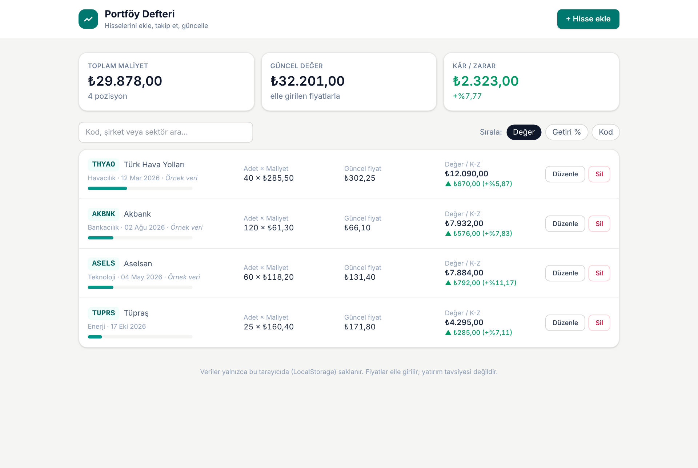
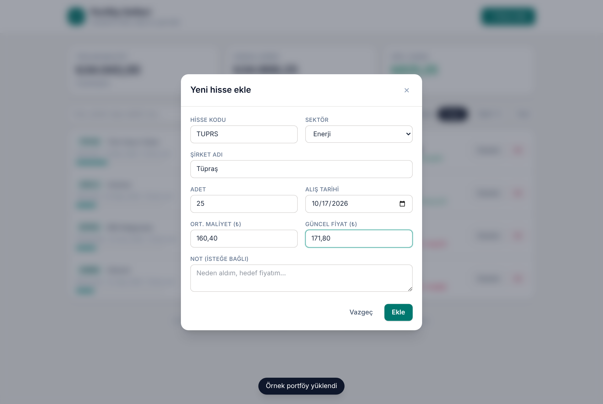
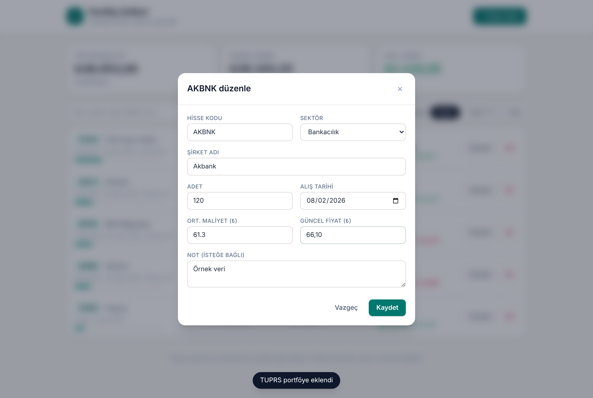
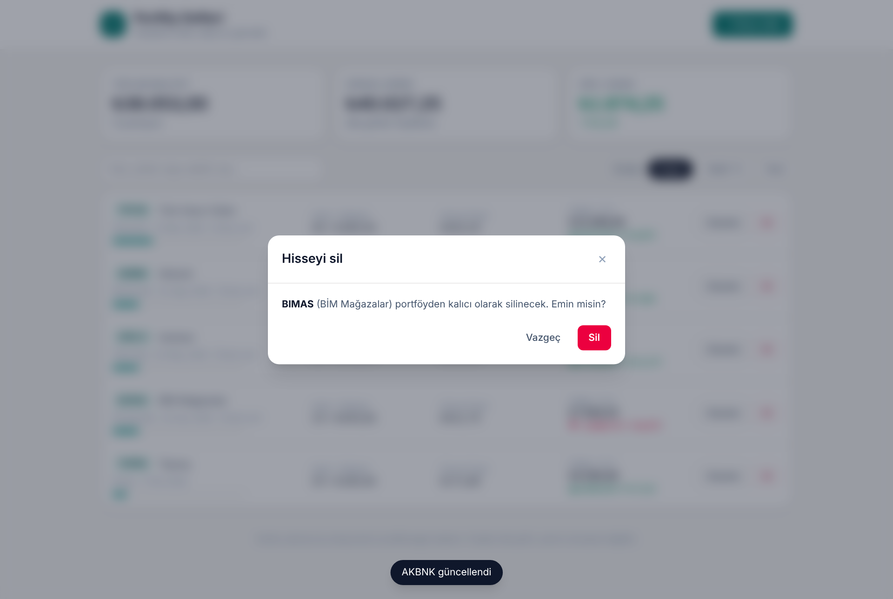

# 📈 Portföy Defteri

Hisse senedi portföyünü **ekleyip, listeleyip, güncelleyip silebileceğin** (CRUD) bir React uygulaması. Veriler tarayıcının **LocalStorage**'ında saklanır; sayfa yenilense de kaybolmaz.

> Web Geliştirme; Yapay Zeka Eğitimi — Proje Ödevi · Eren Kökçam · 2026

**Canlı demo:** _Netlify linkini buraya ekle_



## Özellikler

| İşlem | Nasıl? |
|---|---|
| **Ekle** | "+ Hisse ekle" → hisse kodu, şirket, sektör, adet, ortalama maliyet, güncel fiyat, alış tarihi, not. Form doğrulaması (boş alan, negatif sayı, gelecek tarih, aynı hisseyi iki kez ekleme) |
| **Listele** | Her pozisyon için değer, kâr/zarar (₺ ve %), portföy ağırlığı çubuğu; kod/şirket/sektöre göre arama; değer, getiri % veya koda göre sıralama |
| **Güncelle** | "Düzenle" → aynı form, mevcut değerlerle dolu açılır (ör. güncel fiyatı değiştir) |
| **Sil** | "Sil" → onay penceresi → kalıcı silme |
| Özet | Toplam maliyet, güncel değer ve toplam kâr/zarar kartları |
| Diğer | Mobil uyumlu tasarım, Türkçe sayı/para/tarih biçimi (`Intl`), Esc ile kapanan modal, bildirim (toast) |

## Kullanılan teknolojiler

- **React 19** + **TypeScript**
- **Vite** (geliştirme sunucusu ve build)
- **Tailwind CSS v4** (`@tailwindcss/vite`)
- **LocalStorage** (özel `useLocalStorage` hook'u)
- **Netlify** (yayınlama)

## Klasör yapısı

```
src/
├── components/     # Tekrar kullanılabilir arayüz parçaları
│   ├── EmptyState.tsx
│   ├── HoldingForm.tsx     # Ekle + Güncelle formu (doğrulamalı)
│   ├── HoldingTable.tsx    # Listeleme
│   ├── Modal.tsx
│   └── SummaryCards.tsx
├── pages/
│   └── PortfolioPage.tsx   # State ve CRUD fonksiyonları burada
├── interfaces/
│   └── Holding.ts          # Holding tipi, sektör listesi
├── hooks/
│   └── useLocalStorage.ts
├── utils/
│   └── format.ts           # ₺/% biçimlendirme, kâr-zarar hesapları
├── App.tsx
├── main.tsx
└── index.css
```

## Çalıştırma

```bash
npm install
npm run dev      # http://localhost:5173
npm run build    # dist/ klasörüne üretim çıktısı
```

## Ekran görüntüleri

| Ekleme formu | Düzenleme | Silme onayı |
|---|---|---|
|  |  |  |

Mobil görünüm: [screenshots/mobil.png](screenshots/mobil.png)

> Fiyatlar kullanıcı tarafından elle girilir; uygulamadaki örnek veriler gerçek piyasa fiyatı değildir ve yatırım tavsiyesi niteliği taşımaz.
